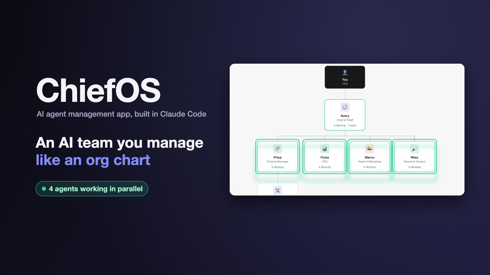
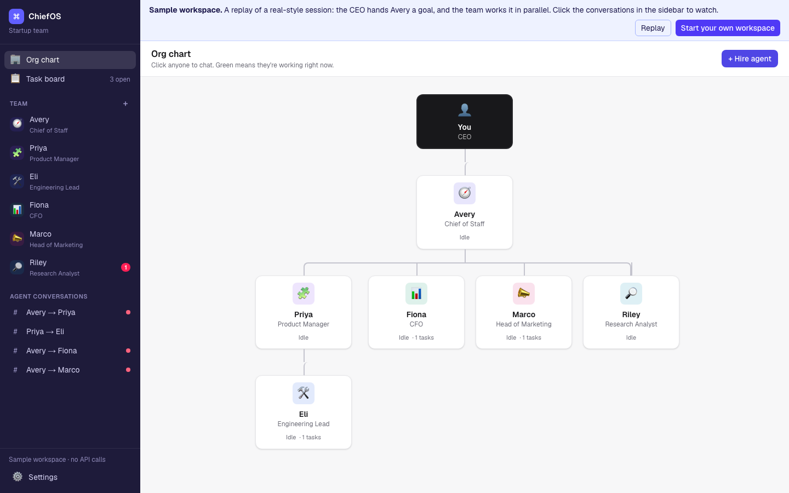
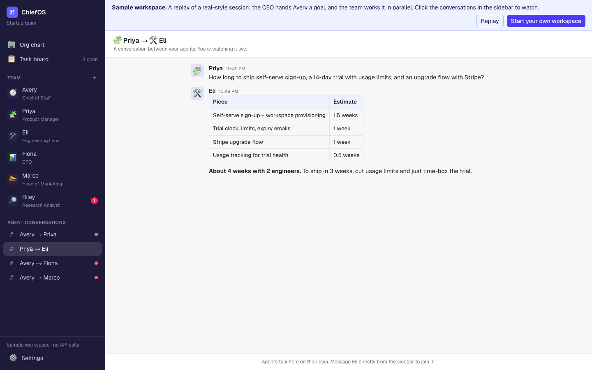
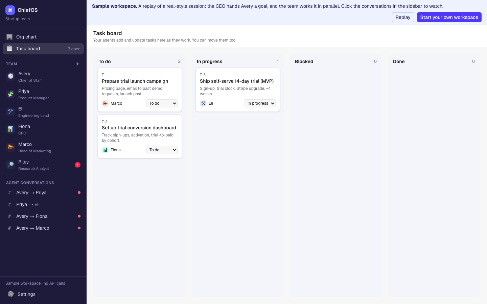
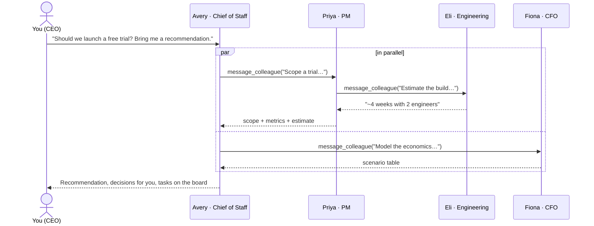

# ChiefOS · manage an AI team like an org chart

*An AI agent management app, built in Claude Code.*

**Chat with your AI chief of staff, product manager, engineer and CFO in parallel, and watch them work with each other.**

ChiefOS is a workspace laid out like Slack, where every employee is an AI agent. You're the CEO. Pick anyone in the
left nav and start a conversation. Ask your CFO about runway while your product manager writes a PRD. Hand your
chief of staff a goal and watch them delegate it: they message the PM, the CFO and marketing **at the same time**,
the PM pulls in the engineer for an estimate, tasks land on a shared board, and you get one recommendation back.

Every agent-to-agent conversation is its own thread you can open and read. Nothing happens in a black box.



> **Try it without an API key:** the app opens with a sample workspace that replays a full session.

---

## Why I built this

Most "AI agent" demos are a single chat box. Real companies don't work like that: work moves between people,
in parallel, through handoffs, with a chief of staff keeping it all on track. I wanted to see what an
**org chart of AI agents** feels like to manage, using the same mental model as running a team:

- **You talk to people, not prompts.** Each agent has a name, a role, a manager and a mission.
- **Work happens in parallel.** Each conversation is an independent Claude session, like several Claude Code
  sessions open side by side.
- **Delegation is visible.** When an agent asks a colleague for help, a new thread appears in the sidebar
  and streams live.
- **Accountability is built in.** Agents put work on a shared task board and keep it current.

## Features

| | |
|---|---|
| 💬 **Parallel chats** | Message any agent. Several agents can be working at once; the sidebar shows who's busy. |
| 🤝 **Agents talk to each other** | Agents use a `message_colleague` tool to delegate or ask for input. Several requests in one turn run concurrently. |
| 🏢 **Live org chart** | See who reports to whom and who's working right now. Click anyone to chat. |
| 📋 **Shared task board** | Agents create and update tasks; you can move them too. |
| 🧑‍💼 **Hire your own agents** | Add, edit or remove agents: name, title, mission, manager, web access. Three starter teams included. |
| 🔎 **Web research** | Agents you allow can search the web (Claude's server-side web search tool). |
| 💸 **Cost meter** | Estimated spend for the workspace, from real token usage at list prices. |
| 🔒 **No backend** | Static site. Your API key stays in your browser and goes only to Anthropic. |
| 🎬 **Demo mode** | A scripted replay of a full session so anyone can see it work with no key. |

## Screenshots

| Org chart | Agents talking to each other | Task board |
|---|---|---|
|  |  |  |

## How it works



**Every thread is its own Claude conversation.** A DM is you ↔ one agent. A team thread is agent ↔ agent; it's
created the first time one agent messages another and continues on later requests, so agents remember earlier
exchanges with each colleague.

**Delegation is a tool call.** Each agent gets these tools:

| Tool | What it does |
|---|---|
| `message_colleague(to, message)` | Opens or continues the team thread, runs the colleague's turn there, and returns their reply as the tool result. |
| `create_task` / `update_task` / `view_task_board` | Read and write the shared task board. |
| `web_search` (optional) | Claude's server-side web search, for agents you allow. |

When a model response contains several `message_colleague` calls, the engine runs them **concurrently**
(`Promise.all`) and returns all results in one message. That's what makes the team feel parallel.

**Guardrails against runaway agents**

- **Budget per request:** every message you send gets a spending cap ($1 by default, set in Settings). It covers
  everything the request sets off; when it's reached, all of its sub-conversations stop at once.
- **Delegation follows the org chart:** the agent you're talking to can reach the whole team; everyone else can
  only delegate to their own direct reports.
- **Depth limit and no loops:** at most You → agent → colleague → colleague, and an agent can't message itself or
  anyone above it in the current chain (the `to` field is a strict enum that excludes them).
- **No duplicate busywork:** agents must check the task board, duplicate titles are rejected, and each request can
  create at most 6 tasks.
- **Turn limit:** at most 8 tool rounds per turn.
- **One turn at a time per thread:** each thread is serialized with a lock; different threads run in parallel.
- **Stop button:** aborts a conversation and every delegated sub-conversation under it, and leaves the history valid.

### What the first live run taught me

I gave the team a real problem: *"Churn jumped from 3% to 5% a month. Diagnose it and bring me a 30-day plan."*
The first version had no budget and let any agent message any other. The agents were genuinely useful: the CFO
modeled the ARR impact (about $307K a year), and the chief of staff correctly escalated what only the CEO could
decide (data access, how churn is defined). But they **over-collaborated**: 18 agent-to-agent threads, 29 tasks
with many duplicates, and about $4.50 of API spend before I stopped it.

That's the same failure mode human orgs have, just faster. The fixes mirror how a good chief of staff runs a
team: a budget per initiative, delegation through reporting lines, and one shared source of truth for tasks.

Then I attacked cost directly. Two-thirds of the bill was **input** tokens: every tool round re-sends the whole
conversation. Prompt caching makes those re-reads ~90-95% cheaper, and an Economy mode runs the team on Claude
Haiku 5.5. Same goal, rerun:

| | First run | After the fixes (Economy mode) |
|---|---|---|
| Cost | $4.53 | **$0.013** |
| API calls | 81 | 19 |
| Agent-to-agent threads | 24 | 4 |
| Tasks created | 37 | 4 |
| Input served from cache | 0% | 53% |
| Final recommendation | not reached | delivered: ranked 30-day plan, revenue scenarios, decisions |

Most of the ~350x comes from the model switch; the guardrails and caching alone cut the same workload by roughly
10x on any model (estimated from token counts). Balanced and Best modes cost more and go deeper.

**Built on the Claude API**

- Three cost modes: **Economy** (Claude Haiku 5.5), **Balanced** (Claude Sonnet 5.5, the default) and **Best**
  (Claude Opus 5.5), each with a matching effort level and per-request budget.
- Prompt caching: an explicit cache breakpoint on the static prefix (tools + system prompt) plus automatic caching
  of the growing conversation, so repeated history is billed at 5-10% of the normal input price.
- Streaming responses, so you watch every agent type.
- Strict tool schemas, with inputs validated by [Zod](https://zod.dev) before anything runs.
- Server-side refusal fallback (`fallbacks: "default"`) enabled on supported models.
- Conversation history is append-only and replayed exactly as received, which preserves thinking blocks between turns.
- `pause_turn` (long web searches) and `max_tokens` stops are handled explicitly.

### Architecture

```
src/
├─ app/page.tsx              Layout: sidebar + current view, settings and hire dialogs
├─ lib/engine.ts             The agent runtime: turns, tools, parallel delegation, guardrails, cost
├─ lib/store.ts              Workspace state (threads, tasks, org, usage) + localStorage persistence
├─ lib/templates.ts          Starter teams: Startup, Product squad, Personal board of directors
├─ lib/demo.ts               Scripted sample session for demo mode
├─ components/Sidebar.tsx    Team list with live status, agent conversations, cost meter
├─ components/ThreadView.tsx Chat UI with streaming markdown and linked activity notes
├─ components/OrgChart.tsx   Org chart tree with live status
├─ components/TaskBoard.tsx  Kanban board
└─ tests/engine.test.ts      Full multi-agent scenario against a fake API (no network, no cost)
```

The engine updates a small external store from outside React (many agents stream at once), and components
subscribe with `useSyncExternalStore`.

## Privacy and cost

- **There is no ChiefOS server.** The app is a static site. Your Anthropic API key is saved in your browser's
  local storage and sent only to `api.anthropic.com`. Conversations are stored only in your browser.
- Calling the API directly from a browser requires the SDK's `dangerouslyAllowBrowser` flag. That's appropriate
  here because it's **your own key on your own device**. Don't deploy ChiefOS with a shared key baked in.
- You pay Anthropic directly for usage. The sidebar shows an estimate and how much input came from the cache.
  Delegation multiplies calls, so a goal handed to the chief of staff costs more than a single chat. Every request
  has a hard budget (Settings), and Economy mode runs a full team request for about a cent.

## Getting started

You need Node.js 20+ and an Anthropic API key ([get one here](https://platform.claude.com/settings/keys)).

```bash
git clone https://github.com/madhurismba-dev/chiefos.git
cd chiefos
npm install
npm run dev
```

Open http://localhost:3000. The sample workspace plays first. Click **Start your own workspace**, paste your API key,
pick a team, and start chatting.

**Try these**

- To Avery (Chief of Staff): *"We're considering a 14-day free trial for our B2B product. Get the team on it and
  bring me a recommendation."*
- To Fiona (CFO), at the same time: *"We have $2.1M in the bank and burn $180K a month. What's our runway?"*
- Then open **Agent conversations** in the sidebar and watch the team work.

### Scripts

| Command | What it does |
|---|---|
| `npm run dev` | Local development server |
| `npm run build` | Static production build in `out/` (deploy anywhere: Netlify, Vercel, GitHub Pages) |
| `npm test` | Runs the multi-agent engine test against a fake API |
| `npm run lint` | ESLint |

## Roadmap ideas

- Shared documents agents can co-edit (PRDs, models) alongside chat
- Scheduled "standups" where the chief of staff collects updates on a cadence
- Approval gates: agents ask the CEO before committing to big decisions
- MCP connectors so agents can read your real calendar, docs and metrics
- Export a thread or the whole workspace as a report

## Tech stack

Next.js 16 (static export) · React 19 · TypeScript · Tailwind CSS 4 · Anthropic TypeScript SDK · Zod · react-markdown

## Author

Built by **Madhuri Siddulagari**, a product leader working on AI, fintech and enterprise SaaS.
Portfolio: [madhuri-pm.netlify.app](https://madhuri-pm.netlify.app)

## License

[MIT](LICENSE)
